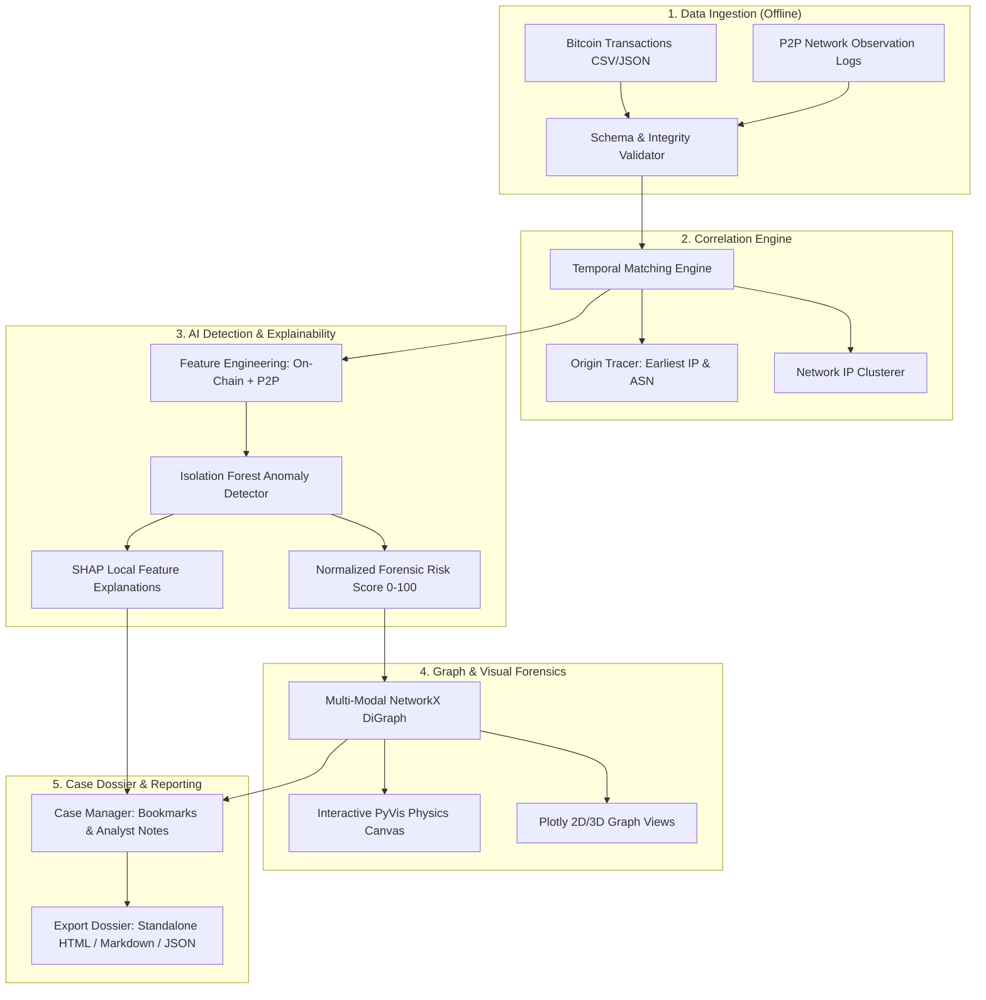

# 🛡️ BlockTrace-AI

> **Offline Bitcoin forensic analysis correlating on-chain blockchain records with P2P network telemetry using Graph Analysis, Isolation Forest, and Explainable AI (SHAP).**

[](https://www.python.org/)
[](https://opensource.org/licenses/MIT)
[](https://streamlit.io/)
[](#offline-air-gapped-security)

---

## 👥 Team Tech Titans
- **Track**: Track B (Product × AI Hackathon)
- **Campus**: NST-RU
- **Members**: Ramit Layek, Nikhil Sharma, Mayank Sharma
- **Product Name**: **BlockTrace-AI**
- **Repository**: [https://github.com/shnikhil06-cyber/BlockTrace-AI.git](https://github.com/shnikhil06-cyber/BlockTrace-AI.git)

---

## 🚨 The Problem in One Line
> *Investigators struggle to link suspicious Bitcoin transactions to network-level activity because blockchain and network data are siloed across separate sources.*

### What's Broken?
1. **Siloed Data**: On-chain ledger data (transactions, blocks, UTXO amounts, addresses) and network-level telemetry (peer node IPs, propagation timestamps, mempool relay logs, ASNs, Tor/VPN exit points) live in isolated systems.
2. **Painful Manual Correlation**: Cybercrime investigators must manually cross-reference timestamps, compare network logs with block explorers, and juggle disjointed tools to deduce transaction origins.
3. **Black-Box Alerting**: Conventional alert rules trigger false positives without explainability, making evidence inadmissible or difficult to defend in judicial investigations.
4. **Cloud / Data Leakage Risks**: Forensic evidence often cannot be uploaded to third-party cloud APIs due to confidentiality, legal chain of custody, and air-gapped laboratory constraints.

---

## 💡 The Solution
**BlockTrace-AI** delivers an end-to-end, **100% offline-first forensic workbench** that ingests local transaction records and network logs, correlates peer propagation timelines to estimate broadcast origins, models multivariate transaction behaviors with **Isolation Forest**, explains anomaly drivers using **SHAP (Shapley Additive exPlanations)**, and visualizes the investigation in an interactive **NetworkX + PyVis graph canvas**.

```
+-----------------------------------------------------------------------------------+
|                                BlockTrace-AI                                      |
+-----------------------------------------------------------------------------------+
|  [ Ingestion ]        [ Correlation ]        [ AI Anomaly & XAI ]   [ Graph & Dossier ]
|  • Local CSV / JSON   • Temporal Alignment   • Isolation Forest     • Multi-Modal Graph
|  • Schema Validation  • Earliest IP Tracer   • Risk Scoring (0-100) • PyVis Canvas
|  • Attack Scenarios   • Tor/VPN/ASN Map      • SHAP Attributions    • Court Reports
+-----------------------------------------------------------------------------------+
```

---

## 🌟 The AI Edge: Why Machine Learning & XAI?

| Challenge | Traditional Rule-Based Tools | BlockTrace-AI Solution |
| :--- | :--- | :--- |
| **Complex Patterns** | Rigid thresholds (e.g. `amount > 10 BTC`) miss subtle laundering | **Isolation Forest** detects multivariate anomalies across volume, sat/vB, fan-out, and propagation speed simultaneously |
| **Network Origin** | Ignored; only on-chain addresses are inspected | **Cross-Source Correlator** pinpoints first-seen broadcast node, ASN, and propagation latency |
| **Explainability** | Opaque black-box alerts ("Risk: 87%") | **SHAP Explainer** reveals exact mathematical feature attributions (+38% fee ratio, +25% fan-out, +18% delay) |
| **Privacy & Security**| Cloud API dependencies risk evidence exposure | **100% Air-Gapped Offline** execution on local machine |

---

## 🏗️ System Architecture



---

## 🎯 Pre-Packaged Forensic Benchmark Scenarios

BlockTrace-AI includes built-in realistic forensic test datasets located in `data/`:

1. **🌀 Peeling Chain Laundering Heist (`peeling_chain.json`)**:
   - A stolen 45 BTC treasury vault peeled sequentially across 8 hops.
   - Small amounts siphoned to cash-out mules; change passed forward to fresh addresses.
   - Broadcast exclusively via Tor exit nodes (`AS200052`) with sub-second relays.
2. **🌪️ CoinJoin / Wasabi Mixer Obfuscation (`mixer_tumbler.json`)**:
   - Multi-party equalized transactions (6 inputs pooling into 12 outputs).
   - Uniform denominations (1.0000 BTC) designed to break UTXO linkability.
   - Synchronized broadcast across 8 international nodes within 15ms.
3. **💥 Ransomware Extortion Rapid Fan-Out (`ransomware_fanout.json`)**:
   - A 30+ BTC extortion payout split immediately into 28 micro-destination addresses.
   - Astronomical fee density (345 sat/vB) paid for emergency next-block inclusion.
   - First observed originating from bulletproof hosting ASN (`AS49981`).
4. **🌱 Benign Baseline Traffic (`baseline_normal.json`)**:
   - Standard 1-in-2-out retail transactions, normal fees, and natural Poisson peer propagation.

---

## 🚀 Quick Start Guide

### Prerequisites
- Python 3.9+ (tested on Python 3.10, 3.11, 3.12, 3.14)
- macOS / Linux / Windows

### 1. Installation
```bash
git clone https://github.com/shnikhil06-cyber/BlockTrace-AI.git
cd BlockTrace-AI

# Create and activate virtual environment
python3 -m venv .venv
source .venv/bin/activate

# Install dependencies and blocktrace package in editable mode
pip install -r requirements.txt
pip install -e .
```

### 2. Launch the Streamlit Forensic Dashboard
```bash
# Using the launcher script:
./run_app.sh

# Or directly:
streamlit run web/app.py
```
Open `http://localhost:8501` in your browser.

---

## 💻 Headless CLI Execution

For automated batch investigations and air-gapped servers without GUI:

```bash
# Run quick end-to-end demo on built-in synthetic benchmarks:
blocktrace demo

# Run forensic pipeline on custom files:
blocktrace run --txs path/to/transactions.csv \
               --net path/to/network_logs.csv \
               --out case_report.html \
               --json case_audit.json \
               --contamination 0.08

# Generate new synthetic forensic scenarios:
blocktrace generate --out-dir data/
```

---

## 🧪 Running Unit & Integration Tests

The project includes automated pytest test suites covering data ingestion, correlation algorithms, Isolation Forest scoring, SHAP explainability, and graph topologies:

```bash
pytest tests/ -v
```

Output:
```
tests/test_case_manager.py::test_case_manager_and_exporter PASSED
tests/test_correlation.py::test_correlation_engine PASSED
tests/test_correlation.py::test_origin_tracer PASSED
tests/test_correlation.py::test_network_clusterer PASSED
tests/test_graph.py::test_graph_construction_and_analysis PASSED
tests/test_ingestion.py::test_generate_and_parse_transactions PASSED
tests/test_ingestion.py::test_generate_and_parse_network_logs PASSED
tests/test_ingestion.py::test_validation_report PASSED
tests/test_ml.py::test_ml_pipeline_and_shap PASSED
============================== 9 passed in 2.70s ===============================
```

---

## 🗺️ Build Plan Alignment

| Milestone | Pitch Deck Commitment | Delivered in Code |
| :--- | :--- | :---: |
| **Week 1: Foundation** | Offline Linux environment, parse local CSV/JSON datasets, build initial correlation engine | ✅ Completed (`blocktrace.ingestion`, `blocktrace.correlation`) |
| **Week 2: Build Out** | Build relationship graphs (NetworkX), integrate Isolation Forest anomaly detection, test synthetic/labeled scenarios, integrate SHAP | ✅ Completed (`blocktrace.ml`, `blocktrace.graph`, `data/scenarios/`) |
| **Week 3: Ship & Polish**| Streamlit offline dashboard, ranked alerts, interactive visual graph, case dossier, HTML/MD/JSON export | ✅ Completed (`web/app.py`, `blocktrace.forensic_case`) |

---

## ⚖️ Forensic Disclaimer & Safety Protocol
- **Probabilistic Risk Indicators**: All anomaly scores (0–100) and SHAP feature attributions generated by BlockTrace-AI are investigative prioritization aids, not definitive judicial proof of criminal activity.
- **Human-in-the-Loop**: The platform keeps human forensic analysts in total control, presenting supporting telemetry with every alert.
- **Data Confidentiality**: BlockTrace-AI operates 100% locally with zero external network callbacks or telemetry collection.

---

## 📜 License
Distributed under the MIT License. Developed for the Product × AI Hackathon by **Tech Titans**.
